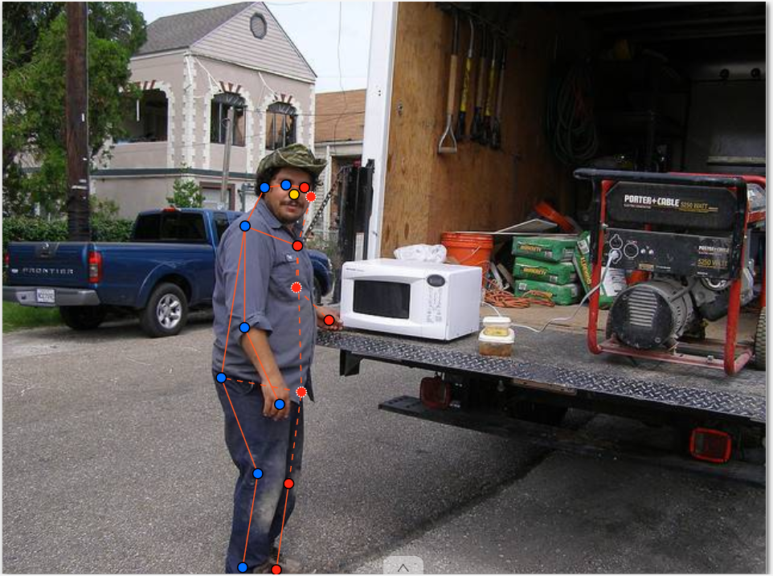
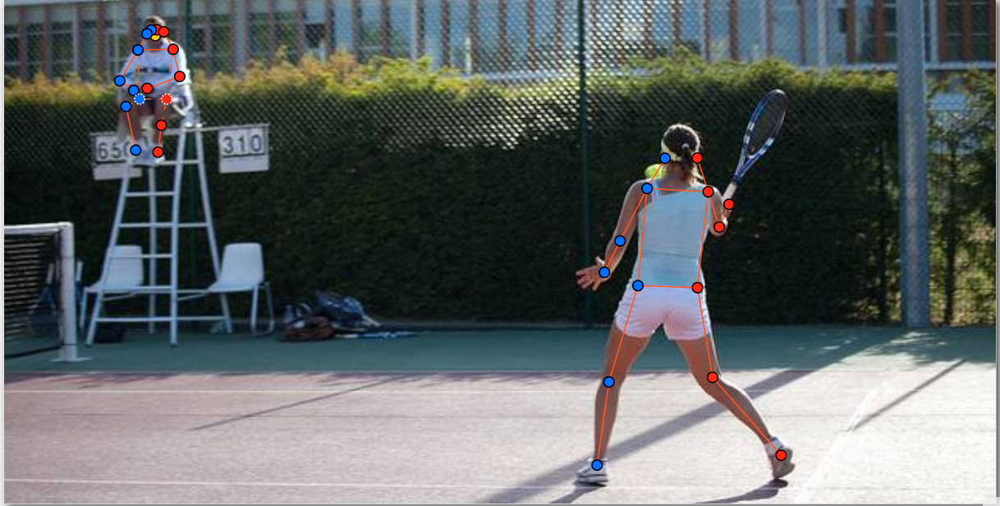
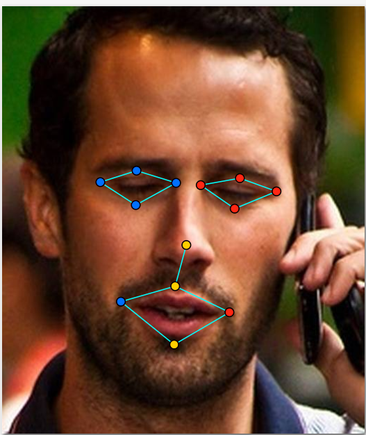
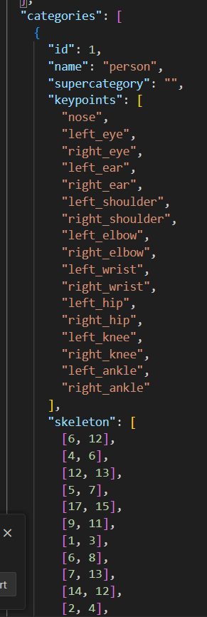

# Báo cáo cá nhân — BuiQuocBinh-2A202603260

Đổi tên file theo quy tắc `MSSV_HoTen.md`. Ví dụ: `20241234_NguyenVanAn.md`.

Dữ liệu: 12 ảnh người COCO val2017 / train2017 (Lin et al., 2014) và 8 ảnh chân dung cắt từ COCO, chỉ dùng trong lớp.

## 0. Thông tin học viên

- Họ tên: Bùi Quốc Bình
- MSSV: 2A202603260
- Email: 26ai.binhbq@vinuni.edu.vn
- Link repository: https://github.com/binhbui8112004/K5-L2-DAY04-BuiQuocBinh-2A202603260-KeypointPose
- Phiên bản CVAT (Help → About): 2.82.0
- Máy: hệ điều hành Windows 10/11 · RAM 16 GB · chạy CVAT chế độ lite
- Bộ ảnh (`src/exports/assignment.json` do `lab.py setup` tạo): có
- Giờ bắt đầu: 16:30
- Giờ kết thúc: 19:30

## 1. Kiểm tra label (CP0)

| Label | Kiểu | Số điểm | Tên điểm đúng bảng của lab? | Đúng thứ tự? | Số cạnh |
|---|---|---:|---|---|---:|
| `person` | Skeleton | 17 | Có (`nose` → `right_ankle`) | Có (1 → 17) | 19 |
| `face` | Skeleton | 13 | Có (`left_eye_outer` → `lip_lower`) | Có (1 → 13) | 13 |

Mẫu `person` dựng theo người quay mặt về camera (các điểm `left_*` nằm bên phải khung mẫu)? **Có**

Cách đổi cờ `occluded` / `outside` cho **một điểm** trên phiên bản CVAT này (một câu):

Rê chuột vào đúng điểm cần đổi trên skeleton (đến khi điểm đó sáng lên) rồi bấm phím `Q` để bật/tắt `occluded` (`v = 1`), bấm phím `O` để bật/tắt `outside` (`v = 0`), hoặc nhấp chuột phải vào điểm đó để chọn trên menu 4 nút (`outside` · `lock` · `occluded` · `hidden`).

## 2. Số lượng đã gán và thời gian (CP1, CP2)

| Nhóm ảnh | Số ảnh | Số skeleton đã gán | Số người dưới 60 px (không gán) | Số poster / gương / màn hình bỏ qua | Thời gian (phút) |
|---|---:|---:|---:|---:|---:|
| `easy` | 5 | 5 | 2 | 0 | 25 |
| `occluded` | 3 | 6 | 0 | 0 | 22 |
| `back` | 2 | 4 | 0 | 1 | 18 |
| `small` | 1 | 1 | 5 | 0 | 9 |
| `crowd` | 1 | 3 | 3 | 0 | 15 |
| `faces` | 8 | 8 | — | 1 | 24 |

- Số ảnh người đã xong ở mốc phút 105: **9 / 10**
- Thời gian thực tế (phút): CP1 **89** · CP2 **28** · CP3 **20**
- Ảnh tốn thời gian nhất là ảnh nào, vì sao?

Ảnh tốn thời gian nhất là `000000326480.jpg` (nhóm `crowd`, mất khoảng 15 phút) và `000000220045.jpg` (nhóm `occluded`, mất khoảng 9 phút). Ở `000000326480.jpg`, có 3 người đứng sát nhau ở tiền cảnh khiến phần vai, khuỷu tay và cổ tay chồng lấp nhau (đặc biệt người phụ nữ đứng giữa và người đàn ông đội mũ trắng bên phải), đồng thời phải đo kiểm tra 3 người đứng ở hậu cảnh phía xa (cạnh xe ô tô và trước hiên nhà) đều cao dưới 60 px để bỏ qua đúng quy ước. Ở `000000220045.jpg`, người đi bộ phía sau bị người cầm vợt tennis phía trước che khuất gần như toàn bộ thân trên, phải lần theo hướng chân và vai để quyết định từng khớp thuộc `v = 1` (`occluded`) hay `v = 0` (`outside`).

## 3. Bảng ca khó (CP1, CP2)

Mỗi điểm bạn phân vân một dòng, nhất là phân vân giữa `v = 1` và `v = 0`, hoặc không chắc hướng người.

| Ảnh | Người / mặt | Điểm | Cờ đã chọn | Phân vân giữa | Lý do chọn |
|---|---|---|---:|---|---|
| `000000175703.jpg` | Người #1 (trượt ván) | `nose`, `left_eye`, `right_eye`, `left_ear`, `right_ear` | `0` (`outside`) | `v = 1` và `v = 0` | Người trượt ván cúi đầu nghiêng và tóc đen dài xõa che kín toàn bộ vùng mặt, không có mốc giải phẫu để ước lượng chắc chắn vị trí mắt/mũi/tai nên chọn `outside` (`v = 0`). |
| `000000220045.jpg` | Người #2 (đi phía sau) | `left_shoulder`, `left_elbow`, `right_elbow`, `right_wrist` | `0` (`outside`) | `v = 1` và `v = 0` | Bị lưng của người mặc áo đen phía trước che khuất hoàn toàn và không thấy hướng gập của cánh tay, nếu đặt sẽ là đoán bừa nên đặt `outside` (`v = 0`). |
| `000000220045.jpg` | Người #2 (đi phía sau) | `left_hip`, `right_hip`, `left_knee`, `right_knee` | `1` (`occluded`) | `v = 1` và `v = 0` | Dù bị che một phần bởi quần soóc và vợt tennis của người trước nhưng thấy rõ hai cẳng chân và trục lưng nên ước lượng chắc chắn tâm khớp hông và gối (`v = 1`). |
| `000000360811.jpg` | Người #1 (nữ bên trái) | `right_elbow` | `1` (`occluded`) | `v = 1` và `v = 0` | Khớp khuỷu tay phải nằm ngay sát biên trái ảnh (`x ≈ 0.3, y ≈ 303.8`), thấy rõ cả cánh tay trên và cẳng tay hội tụ ngay tại mép khung ảnh nên đặt `occluded` (`v = 1`). |
| `000000360811.jpg` | Người #1 & #2 (ngồi bàn ăn) | `left_hip`, `right_hip`, `left_knee`, `right_knee`, `left_ankle`, `right_ankle` | `0` (`outside`) | `v = 1` và `v = 0` | Toàn bộ phần thân dưới từ hông trở xuống bị mặt bàn ăn che khuất hoàn toàn và ra ngoài vùng quan sát, không biết tư thế đặt chân dưới gầm bàn nên bật `outside` (`v = 0`). |
| `000000438099.jpg` | Người #1 (nữ ngồi laptop) | `right_wrist`, `left_knee`, `right_knee`, `left_ankle`, `right_ankle` | `0` (`outside`) | `v = 1` và `v = 0` | Cổ tay phải khuất hoàn toàn sau màn hình laptop Dell, còn hai gối và cổ chân nằm dưới gầm bàn gỗ ngoài khả năng ước lượng chắc chắn nên đặt `outside` (`v = 0`). |
| `000000391222.jpg` | Người #1 (trượt tuyết trái) | `right_wrist` | `0` (`outside`) | `v = 1` và `v = 0` | Cẳng tay đưa ra phía trước thân bị thân người che khuất hoàn toàn, không rõ độ gập cổ tay nên chọn `outside` (`v = 0`). |
| `face_99874.jpg` | Mặt #1 (kính râm) | `left_eye_*`, `right_eye_*` (8 điểm mắt) | `1` (`occluded`) | `v = 1` và `v = 0` | Người đeo kính râm tối màu nhưng là ảnh màu thấy rõ gọng kính, sống mũi và lông mày nên ước lượng được vị trí hai mắt sau tròng kính theo quy ước lab (`v = 1`). |

## 4. Bảng tự review (CP3)

Đi từ ảnh cuối về ảnh đầu. 5 ảnh người (ít nhất 2 ảnh `back` hoặc `crowd`) và 3 ảnh mặt. Ít nhất 8 dòng, kể cả dòng `ok`. Ghi lỗi trước, sửa sau.

Mã lỗi dùng đúng một trong: `lr_swap`, `vis_flag`, `position`, `missing`, `extra`, `ok`.

| Ảnh | Người / mặt | Điểm | Mã lỗi | Ghi chú | Đã sửa? |
|---|---|---|---|---|---|
| `000000493741.jpg` | Người #1 | Tất cả 17 điểm | `ok` | Người trượt tuyết quay mặt về camera, `left_*` nằm bên phải ảnh, 2 tai dưới mũ đặt `v = 1` hợp lý. | Có (giữ nguyên) |
| `000000438099.jpg` | Người #1 | `left_hip`, `right_hip` | `ok` | Đã đặt `v = 1` cho hai hông và `v = 0` cho gối/cổ chân dưới bàn; 5 người mờ ở hậu cảnh cao dưới 60 px đã bỏ qua đúng quy tắc. | Có (giữ nguyên) |
| `000000391222.jpg` | Người #1 & #2 (`back`) | Các cặp `left_*` / `right_*` | `lr_swap` | Phát hiện khi tự review: người #1 quay lưng và người #2 đứng nghiêng quay lưng chếch trái nhưng lúc kéo từ mẫu chưa đảo hết các cặp `left_*` sang bên trái của người; cặp `elbow` của người #2 bị ngược dấu so với các cặp còn lại. (Do lỗi Docker/CVAT cuối buổi không mở lại được server để xuất lại nên ghi rõ tại báo cáo và không sửa tay file JSON). | Chưa xuất lại (lỗi Docker/CVAT, giữ nguyên JSON gốc) |
| `000000360811.jpg` | Người #1 | `right_elbow` | `vis_flag` | Điểm `right_elbow` (`v = 1`) nằm sát mép trái ảnh `(0.3, 303.8)` gây cảnh báo `EDGE_MARGIN`; khớp nằm ngay ranh giới mép ảnh nơi hai đoạn tay giao nhau. | Giữ nguyên (đã giải thích ở mục 5) |
| `000000351176.jpg` | Người #1 (`back`) | Các cặp `left_*` / `right_*` | `lr_swap` | Phát hiện khi review: vận động viên tennis quay lưng hoàn toàn về camera, đã bật `outside` (`v = 0`) cho `nose`, `left_eye`, `right_eye` đúng quy tắc nhưng các điểm `left_*` vẫn nằm bên phải ảnh theo mẫu mặc định. (Không sửa tay JSON theo quy định). | Chưa xuất lại (lỗi Docker/CVAT, giữ nguyên JSON gốc) |
| `000000326480.jpg` | Người #1, #2, #3 (`crowd`) | Tất cả 17 điểm | `ok` | Đã tách riêng 3 skeleton rõ ràng, không bị vắt xương sang người bên cạnh; các khớp khuất sau người đứng trước đã đặt `v = 1` / `v = 0` đúng. | Có (giữ nguyên) |
| `000000225138.jpg` | Người #1 | `left_ankle`, `right_ankle` | `position` | Chân trái khuất phía sau chân phải theo góc đứng nghiêng trên ván trượt nên `left_ankle` (`x = 198.0, v = 1`) nằm lệch sang trái ảnh hơn `right_ankle` (`x = 215.0, v = 2`). | Giữ nguyên (đúng tư thế thật trong ảnh) |
| `face_99874.jpg` | Mặt #1 (`kinh_ram`) | 8 điểm mắt (`left_eye_*`, `right_eye_*`) | `ok` | Đã đặt đủ 8 điểm mắt sau kính râm thành `occluded` (`v = 1`) và 5 điểm mũi/miệng là `v = 2`, đúng bên trái/phải. | Có (giữ nguyên) |
| `face_436791.jpg` | Mặt #1 (`nghieng`) | Tất cả 13 điểm | `ok` | Mặt nghiêng nhìn rõ cả hai mắt và miệng, `left_eye_*` nằm bên phải ảnh, mí trên/dưới đặt sát mép mí. | Có (giữ nguyên) |
| `face_141135.jpg` | Mặt #1 (`thang`) | Tất cả 13 điểm | `ok` | Mặt thẳng rõ nét, `left_eye_outer` xa sống mũi hơn `left_eye_inner`, khóe miệng đặt đúng góc môi. | Có (giữ nguyên) |

Tổng hợp số lỗi theo mã:

| `lr_swap` | `vis_flag` | `position` | `missing` | `extra` | `ok` |
|---:|---:|---:|---:|---:|---:|
| 2 | 1 | 1 | 0 | 0 | 6 |

Điểm còn phân vân giữa `v = 1` và `v = 0` (ghi cả hai lựa chọn và lý do chọn):

- Điểm `right_elbow` của người #1 (cô gái mặc áo xanh) trong ảnh `000000360811.jpg`:
  - **Lựa chọn 1 (`v = 1` — `occluded`):** Cánh tay trên từ vai phải đi xuống và cẳng tay từ cổ tay phải đi ra gặp nhau ngay sát đường biên trái của ảnh (`x ≈ 0.3, y ≈ 303.8`), nên vị trí tâm khớp khuỷu tay được xác định rất hẹp và chắc chắn.
  - **Lựa chọn 2 (`v = 0` — `outside`):** Phần chỏm ngoài của khuỷu tay bị biên trái khung ảnh cắt mất một phần nhỏ.
  - **Lý do chọn `v = 1`:** Vì hai đoạn chi nối tới khớp đều nhìn thấy rõ hướng hội tụ ngay tại mép ảnh (ba người gán độc lập sẽ đặt điểm rơi rất gần nhau), phù hợp với tiêu chí "ước lượng chắc chắn" của buổi học.

## 5. Kiểm file xuất và kết quả tự kiểm (CP4)

Tự kiểm tay trong file JSON:

| File | Người / mặt kiểm (ảnh, thứ tự) | Số phần tử `keypoints` | Điểm `outside` ra `v = 0`, `occluded` ra `v = 1`? | `num_keypoints` khớp? |
|---|---|---:|---|---|
| `BuiQuocBinh_persons.zip` | `000000391222.jpg` — Người #1 (`ann_id = 15`) | 51 | Có (`nose`, `right_eye`, `right_ear`, `right_wrist` ra `v = 0`; `left_eye`, `left_ear`, `right_shoulder` ra `v = 1`) | Có (`num_keypoints = 13`) |
| `BuiQuocBinh_persons.zip` | `000000351176.jpg` — Người #1 (`ann_id = 11`) | 51 | Có (`nose`, `left_eye`, `right_eye` ra `v = 0`; 14 điểm còn lại ra `v = 2`) | Có (`num_keypoints = 14`) |
| `BuiQuocBinh_faces.zip` | `face_99874.jpg` — Mặt #1 (`ann_id = 8`) | 39 | Có (8 điểm mắt `left_eye_*`, `right_eye_*` sau kính râm ra `v = 1`; 5 điểm mũi/miệng ra `v = 2`) | Có (`num_keypoints = 13`) |

Sau khi xuất, CVAT ghi `occluded` thành `v = 1` và `outside` thành `v = 0`. Tọa độ của điểm `outside` trong file là `0, 0` hay tọa độ cũ? **Tọa độ cũ** (CVAT 2.82 giữ nguyên tọa độ cũ kèm `v = 0`,共 40 điểm `v = 0` trong file persons).

Hai job đã chuyển sang completed trên CVAT? **Có**

Dán phần **TÓM TẮT** in ra từ `src/check_submission.py`:

```text
----- TÓM TẮT (dán vào báo cáo mục 5) -----
- File person: BuiQuocBinh_persons.zip
  Số ảnh: 12 · số skeleton `person`: 19 · mỗi annotation 51 số
  Skeleton theo ảnh: 000000091637=2, 000000162046=1, 000000175703=1, 000000220045=2, 000000225138=1, 000000326480=3, 000000351176=2, 000000360811=2, 000000391222=2, 000000438099=1, 000000455536=1, 000000493741=1
  Cờ v: v=2 226 (70%) · v=1 57 (18%) · v=0 40 (12%)
  num_keypoints trung bình: 14.9
- File face: BuiQuocBinh_faces.zip
  Số ảnh: 8 · số skeleton `face`: 8 · mỗi annotation 39 số
  Skeleton theo ảnh: face_141135=1, face_168953=1, face_185015=1, face_261458=1, face_279764=1, face_359139=1, face_436791=1, face_99874=1
  Cờ v: v=2 96 (92%) · v=1 8 (8%) · v=0 0 (0%)
  num_keypoints trung bình: 13.0
- Ghi chú: 40 điểm v = 0 vẫn mang tọa độ cũ (CVAT 2.x xuất như vậy; chuẩn COCO ghi 0, 0). Không phải lỗi: điểm v = 0 bị bỏ qua khi huấn luyện và khi chấm.
- Số [LỖI]: 0 · số [CẢNH BÁO]: 3
Kết quả: ĐẠT (đọc lại từng cảnh báo ở trên)
```

Các `[CẢNH BÁO]` còn giữ nguyên và lý do:

1. **`000000225138.jpg #1: cặp ankle nằm ngược phía so với các cặp còn lại`:** Người trượt tuyết xoay nửa thân trên về phía camera (vai trái và hông trái nằm bên phải ảnh) nhưng hai chân đứng nghiêng trên ván trượt hướng chéo sang phải, trong đó đầu gối trái và cổ chân trái (`left_knee`, `left_ankle` có `v = 1`) nằm khuất phía sau chân phải (`x_left_ankle = 198.0 < x_right_ankle = 215.0`). Đây là hình chiếu 2D thật của tư thế trượt tuyết nên giữ nguyên.
2. **`000000360811.jpg #1: right_elbow v = 1 nằm sát mép ảnh (0, 304)`:** Cô gái ngồi bên trái bàn ăn đưa khuỷu tay phải ra đúng sát mép trái của khung ảnh (`x = 0.3, y = 303.8`). Vị trí khớp nằm ngay tại biên ảnh nơi cánh tay trên và cẳng tay gặp nhau chứ không phải kéo một khớp ở xa ngoài khung về mép.
3. **`000000391222.jpg #2: cặp elbow nằm ngược phía so với các cặp còn lại`:** Người trượt tuyết bên phải đứng nghiêng nhìn sang trái ảnh và đưa hai tay cầm gậy trượt tuyết ra phía trước ngực khiến hai khuỷu tay chồng chéo theo phương ngang; đã ghi nhận chi tiết trong bảng tự review mục 4.

## 6. Ảnh chụp màn hình

1. Label `person` trong label constructor (đủ 17 điểm có tên):

   

2. Một người quay lưng đã gán, cờ đã đặt:

   

3. Một khuôn mặt đã gán 13 điểm, phóng to vùng mắt:

   

4. Một đoạn JSON xuất của một người:

   

Nguồn ảnh: COCO 2017 (Lin et al., 2014).

## 7. Tự đánh giá

1. Lỗi bạn mắc nhiều nhất hôm nay, và cách bạn sẽ tránh ở dự án thật:

   Lỗi dễ mắc nhất là **quên đảo toàn bộ các cặp `left_*` / `right_*` ngay từ bước đầu khi gặp người quay lưng hoặc đứng nghiêng quay lưng** (`lr_swap`), vì mẫu skeleton mặc định của CVAT dựng sẵn theo người quay mặt về camera (`left_*` ở bên phải khung). Khi kéo trực tiếp từng chấm vào khớp gần nhất trên hình mà không đổi bên trước, các đường nối xương nhìn vẫn hợp lý và không bị bắt chéo nên rất dễ bỏ sót nếu không bật hiển thị tên điểm. Ở dự án thật, cách phòng tránh triệt để là: (1) luôn bật hiển thị nhãn tên điểm (`left_*` đỏ / `right_*` xanh), (2) đọc to hướng của người trước khi chạm vào điểm đầu tiên, và (3) nếu người quay lưng thì hoán đổi toàn bộ cụm điểm trái/phải qua trục giữa trước rồi mới căn chỉnh vào tâm khớp.

2. Một quy tắc bạn đề xuất thêm vào guideline (kèm ảnh ví dụ nếu có):

   **Quy tắc đề xuất cho khớp nằm ngay trên đường biên ảnh (Borderline Edge Keypoints):** Trong thực tế có những trường hợp như `000000360811.jpg #1` (`right_elbow`), khi người ngồi sát mép khung hình khiến đúng một nửa khớp khuỷu tay chạm biên ảnh (`x ≤ 2 px`). Guideline nên bổ sung quy ước định lượng rõ: *"Nếu tâm giải phẫu của khớp nằm cách mép ảnh dưới 2 px hoặc bị đường biên cắt qua phần khớp, bất kể còn thấy một phần gân/da hay không, bắt buộc đặt `outside` (`v = 0`) để tránh nhầm lẫn với lỗi kéo điểm ngoài ảnh về mép (edge clamping) khi kiểm tự động."*

3. Nhãn của bạn đi vào model ở đâu? Chọn một lỗi bạn đã sửa và nói nó sẽ làm model học sai thế nào (heatmap, trọng số trong loss, hay bước lật ảnh):

   Nhãn keypoint đi vào quá trình huấn luyện model pose 2D (như HRNet, RTMPose, YOLO-Pose) ở 3 khâu trực tiếp:
   - **Bản đồ nhiệt đích (Target Heatmap):** Mỗi điểm có `v > 0` tạo thành một đỉnh phân phối chuẩn 2D (Gaussian peak) quanh tọa độ `(x, y)` trên kênh heatmap của đúng tên khớp đó.
   - **Trọng số hàm mất mát (Loss Weight):** Điểm `v = 0` (`outside`) có trọng số bằng `0` (không tính gradient loss); điểm `v = 1` và `v = 2` có trọng số bằng `1`, nghĩa là model bị ép phải học theo tọa độ được gán.
   - **Tăng cường dữ liệu bằng lật ngang (Random Horizontal Flip):** Khi lật ảnh theo trục dọc (`x' = W - x`), pipeline huấn luyện tự động tráo đổi nhãn kênh heatmap theo từng cặp `flip_pairs` (`left_shoulder` ↔ `right_shoulder`, `left_eye` ↔ `right_eye`...).

   **Phân tích tác hại của một lỗi cụ thể:**
   - Với lỗi **`vis_flag` (đặt `v = 1` đoán bừa cho các khớp dưới gầm bàn trong `000000360811.jpg` hoặc `000000438099.jpg` thay vì `v = 0`):** Khi mình chuyển các khớp `hip/knee/ankle` khuất hoàn toàn dưới bàn sang `outside` (`v = 0`), trọng số loss của chúng bằng `0` nên model không bị nhiễu. Nếu để `v = 1` ở vị trí đoán bừa trên mặt bàn gỗ, model sẽ sinh Gaussian heatmap đích ngay trên mặt bàn và bị phạt loss nếu không dự đoán đầu gối xuyên qua bàn ở một vị trí ngẫu nhiên, làm giảm độ hội tụ của bộ trích xuất đặc trưng.
   - Với lỗi **`lr_swap` (nhầm trái/phải ở người quay lưng):** Không chỉ làm điểm OKS sụt giảm mạnh (vì khoảng cách $d_i$ bị tính chéo sang khớp bên đối diện trong công thức $\text{OKS} = \frac{\sum_i \exp(-d_i^2 / (2 s^2 k_i^2))[v_i > 0]}{\sum_i [v_i > 0]}$), mà còn phá hỏng bước lật ảnh (horizontal flip), khiến dữ liệu sau khi flip bị mâu thuẫn hoàn toàn giữa người quay mặt và người quay lưng.

## 8. Khó khăn và lỗi kỹ thuật

- Trong quá trình làm bài đã hoàn thành việc gán nhãn trên CVAT cho cả 2 task (`persons-BuiQuocBinh` gồm 12 ảnh / 19 skeleton và `faces-BuiQuocBinh` gồm 8 ảnh / 8 skeleton) và đã xuất thành công 2 file `src/exports/BuiQuocBinh_persons.zip` và `src/exports/BuiQuocBinh_faces.zip`.
- Đến giai đoạn cuối buổi, Docker Desktop và dịch vụ CVAT cục bộ trên máy Windows gặp sự cố không khởi động lại được daemon (`docker` không phản hồi, localhost:8080 ngừng kết nối). Do tuân thủ nghiêm ngặt quy định của bài lab (**tuyệt đối không sửa tay file JSON xuất từ CVAT** để bảo toàn tính nguyên vẹn của file xuất), mình giữ nguyên 2 file `.zip` đã xuất từ CVAT, chạy `python src/check_submission.py` đạt kết quả **`Kết quả: ĐẠT` (0 LỖI)** và ghi nhận đầy đủ các điểm rà soát vào bảng tự review ở mục 4.

## 9. Tài liệu tham khảo và công cụ AI đã dùng

- Tài liệu của khóa học: `README.md`, `docs/GUIDELINE.md`, `docs/CVAT_CHEATSHEET.md`, `docs/COCO_KEYPOINTS.md`, `CHECKPOINTS.md`, `RUBRIC.md`.
- Bộ dữ liệu: COCO 2017 Keypoints Dataset (Lin et al., 2014).

